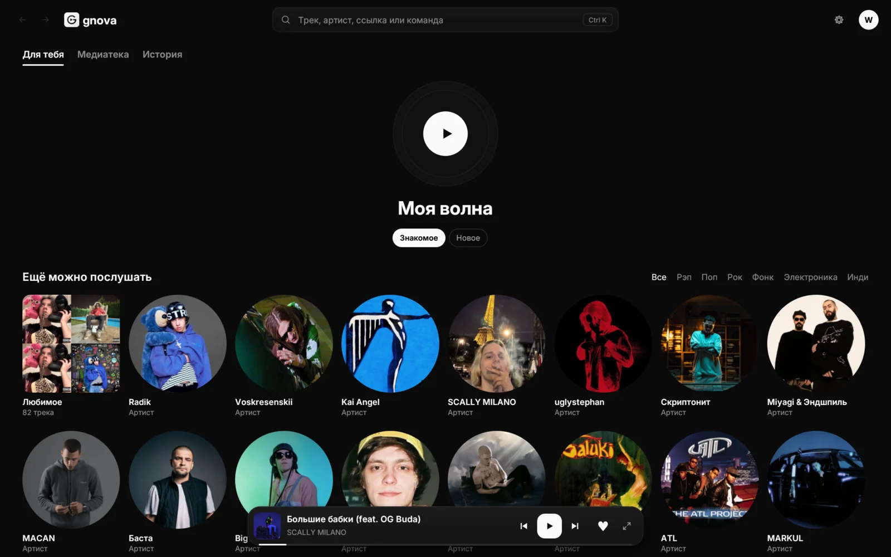
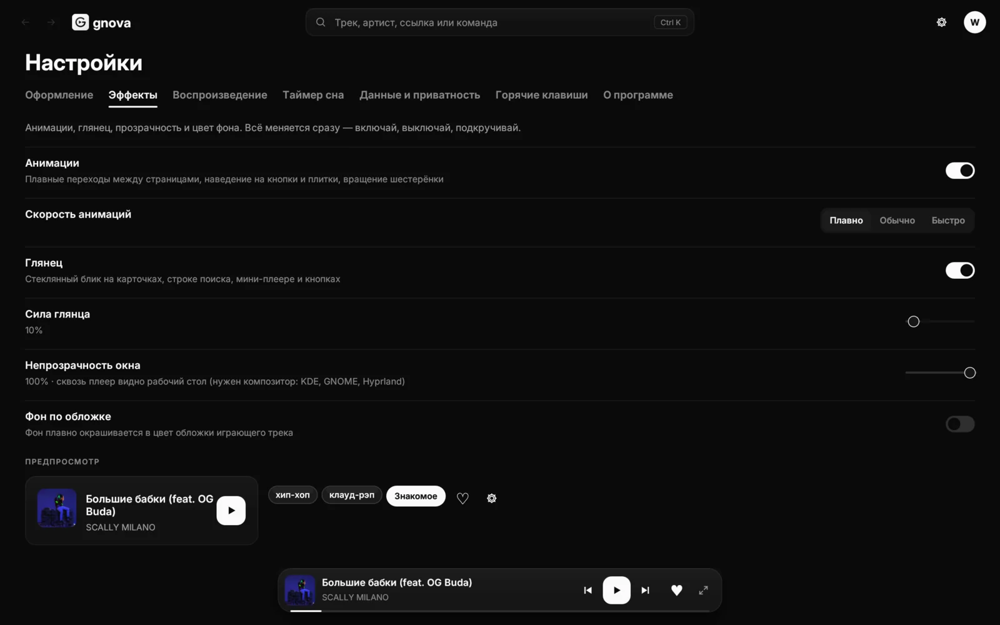
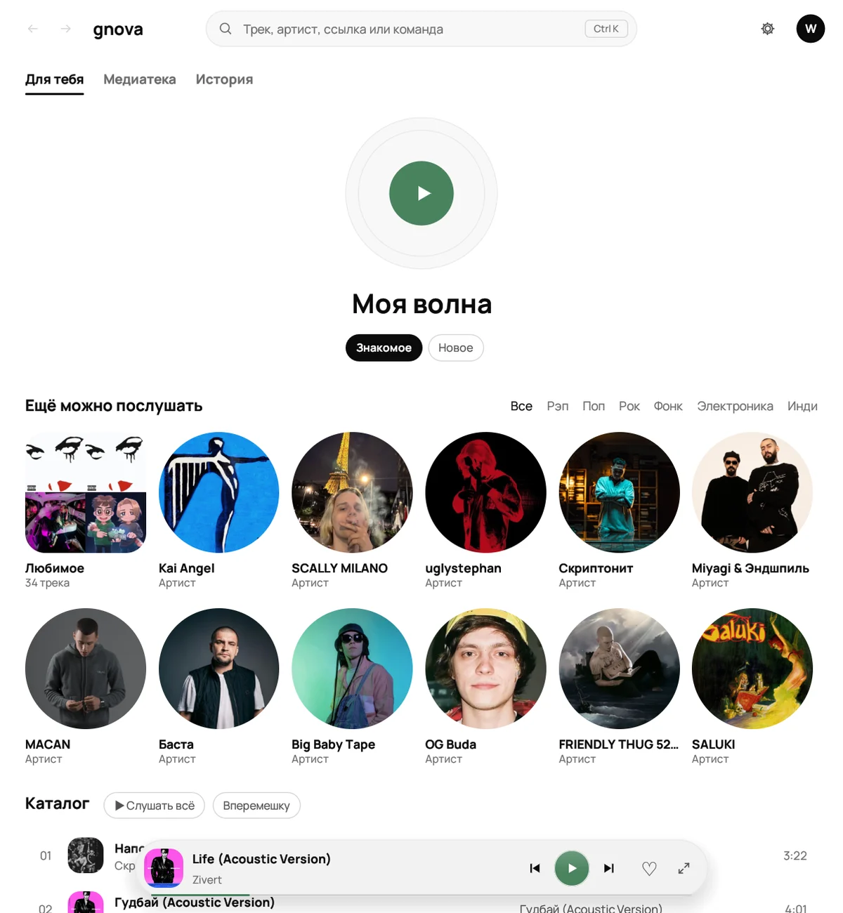

<p align="center">
  
</p>

<h1 align="center">Gnova Music</h1>

<p align="center">
  Быстрый музыкальный плеер для компьютера: SoundCloud и музыка с диска, синхронный текст песен,
  «Моя волна», без рекламы, аккаунта и сбора данных.
</p>

<p align="center">
  <a href="https://github.com/W1nq-coder/gnova-music-download/releases/latest/download/Gnova-Setup-Windows.exe"><b>⬇ Скачать для Windows</b></a>
  &nbsp;·&nbsp;
  <a href="#linux"><b>⬇ Установить на Linux</b></a>
  &nbsp;·&nbsp;
  <a href="https://github.com/W1nq-coder/gnova-music-download/releases/latest">Все файлы</a>
</p>

<p align="center">
  
  
</p>

## Что умеет

- Поиск и прослушивание SoundCloud: треки, артисты, альбомы, плейлисты.
- Музыка с компьютера: перетащите файлы или папку в окно (MP3, FLAC, OGG, WAV, M4A, AAC).
- Текст песен с подсветкой текущей строки; клик по строке перематывает трек.
- «Моя волна»: бесконечная подборка по вашему вкусу.
- Любимое, плейлисты, история, таймер сна, скорость воспроизведения.
- Темы и цвета, прозрачность окна, обложки в цвет интерфейса.
- Окно подстраивается под любой экран: от узкого окна до большого монитора.
- Нет аккаунта, рекламы и аналитики: всё хранится только у вас на компьютере.

## Системные требования

| Система | Что нужно |
|---|---|
| **Windows** | Windows 10 или 11, 64-бит |
| **Linux** | x86_64, glibc 2.35+ (Ubuntu 22.04+, Debian 12+, Fedora 36+, Arch/CachyOS/Manjaro и др.), Wayland или X11 |
| **Android** | пока нет, версия для телефона в разработке |
| **macOS** | пока нет |

Нужен интернет для SoundCloud и текстов песен; музыка с диска играет и без него.

## Windows

### Способ 1: установщик (проще всего)

1. Скачайте **[Gnova-Setup-Windows.exe](https://github.com/W1nq-coder/gnova-music-download/releases/latest/download/Gnova-Setup-Windows.exe)**.
2. Запустите его. Права администратора не нужны.
3. Выберите, нужен ли ярлык на рабочем столе и запуск вместе с Windows, и нажмите «Установить».

Gnova появится в меню «Пуск». Удалить: **Параметры → Приложения → Gnova Music → Удалить**.

> **Windows показала «Windows защитила ваш компьютер»?** Это обычное предупреждение для программ
> без платной цифровой подписи. Нажмите **«Подробнее» → «Выполнить в любом случае»**.

### Способ 2: одной командой

Откройте **PowerShell** и вставьте:

```powershell
irm https://raw.githubusercontent.com/W1nq-coder/gnova-music-download/main/install.ps1 | iex
```

Скрипт скачает установщик и сам поставит Gnova с ярлыком на рабочем столе.

### Способ 3: без установки

Скачайте **[gnova-windows-x64.zip](https://github.com/W1nq-coder/gnova-music-download/releases/latest/download/gnova-windows-x64.zip)**,
распакуйте в любую папку и запустите `gnova.exe`.

## Linux

### Способ 1: одной командой

Откройте терминал и вставьте:

```bash
curl -fsSL https://raw.githubusercontent.com/W1nq-coder/gnova-music-download/main/install.sh | bash
```

Root не нужен. Gnova установится в `~/.local/bin` и появится в меню приложений.

### Способ 2: вручную

```bash
wget https://github.com/W1nq-coder/gnova-music-download/releases/latest/download/gnova-linux-x86_64.tar.gz
tar -xzf gnova-linux-x86_64.tar.gz
./gnova/gnova --install     # в меню приложений
# или просто запустить:  ./gnova/gnova
```

### Если не запускается

Gnova использует стандартные библиотеки рабочего стола. Обычно они уже стоят, если нет — поставьте:

| Дистрибутив | Команда |
|---|---|
| Arch, CachyOS, Manjaro | `sudo pacman -S --needed alsa-lib gtk3 libxkbcommon` |
| Ubuntu, Debian, Mint | `sudo apt install libasound2 libgtk-3-0 libxkbcommon0` |
| Fedora | `sudo dnf install alsa-lib gtk3 libxkbcommon` |

### Удаление

```bash
curl -fsSL https://raw.githubusercontent.com/W1nq-coder/gnova-music-download/main/uninstall.sh | bash
```

Медиатека и настройки при этом остаются. Чтобы удалить и их, скачайте `uninstall.sh` и запустите
`bash uninstall.sh --purge`.

## Где хранятся ваши данные

Всё хранится только на вашем компьютере и никуда не отправляется.

| | Windows | Linux |
|---|---|---|
| Медиатека (любимое, плейлисты, история) | `%APPDATA%\gnova` | `~/.local/share/gnova` |
| Настройки | `%APPDATA%\gnova` | `~/.config/gnova` |
| Кэш обложек | `%LOCALAPPDATA%\gnova` | `~/.cache/gnova` |

Тексты песен ищутся на [lrclib.net](https://lrclib.net) по названию и исполнителю. Это можно
выключить в «Настройки → Данные и приватность».

## Горячие клавиши

| Клавиша | Действие |
|---|---|
| `Пробел` | пауза / продолжить |
| `Ctrl + K` | поиск и команды |
| `F11` | плеер на весь экран: текст и очередь |
| `L` | в любимое |
| `S` / `R` | перемешать / повтор |
| `M` | без звука |

Полный список в «Настройки → Горячие клавиши».

## Ещё скриншоты

<p align="center">
  
  
  
</p>

---

<details>
<summary><b>English</b></summary>

**Gnova Music** is a fast desktop music player: SoundCloud and local files, synced lyrics,
an endless "My wave" mix. No ads, no account, no tracking.

- **Windows 10/11 (64-bit):** download
  [Gnova-Setup-Windows.exe](https://github.com/W1nq-coder/gnova-music-download/releases/latest/download/Gnova-Setup-Windows.exe)
  and run it (no admin rights). If SmartScreen warns, click *More info → Run anyway*.
  Or in PowerShell: `irm https://raw.githubusercontent.com/W1nq-coder/gnova-music-download/main/install.ps1 | iex`
- **Linux (x86_64, glibc 2.35+):**
  `curl -fsSL https://raw.githubusercontent.com/W1nq-coder/gnova-music-download/main/install.sh | bash`
- **Android / macOS:** not yet.

All your data stays on your computer.
</details>
