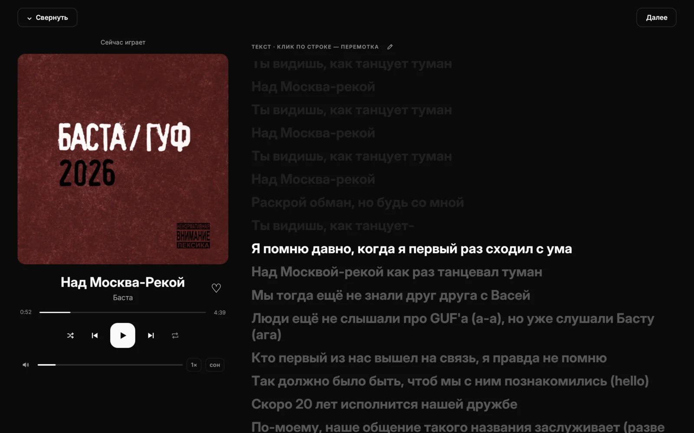
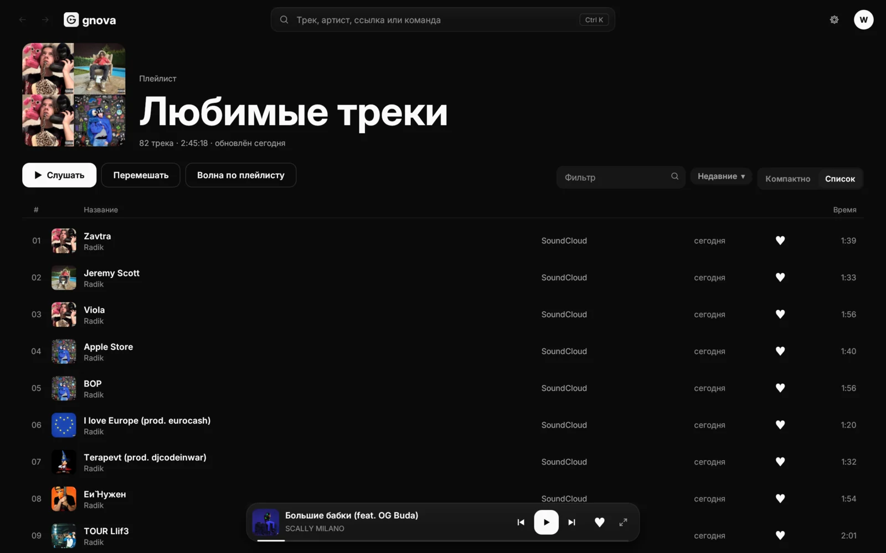
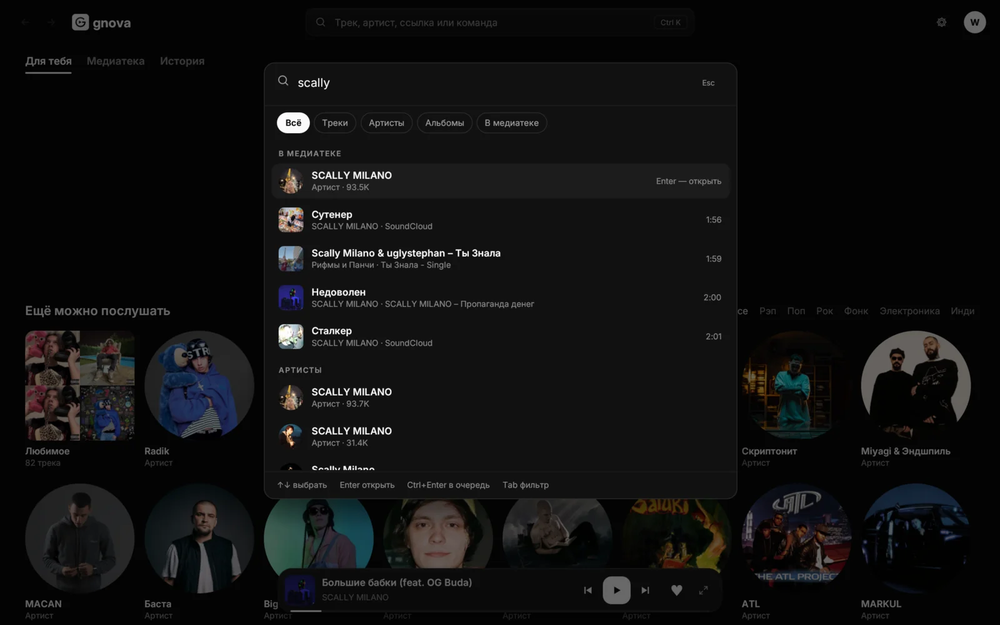
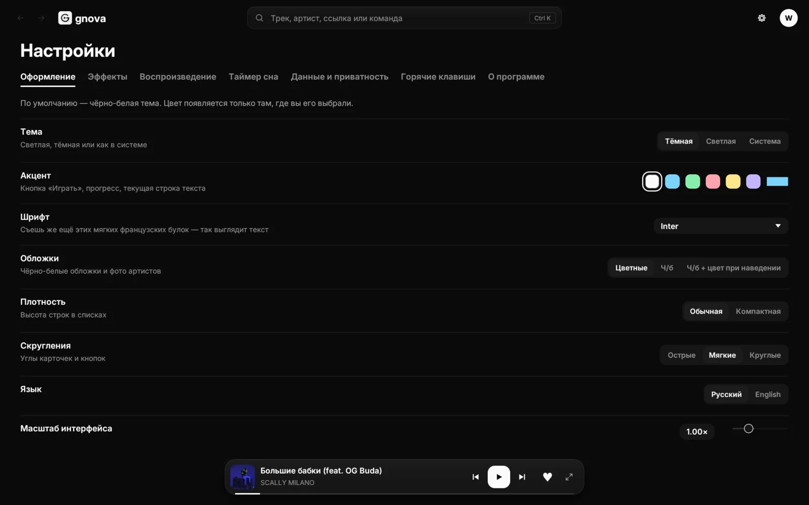
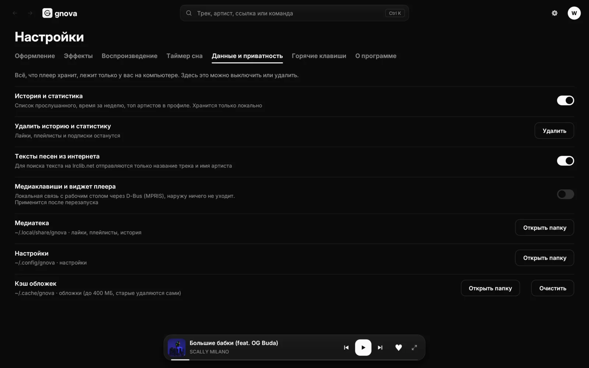
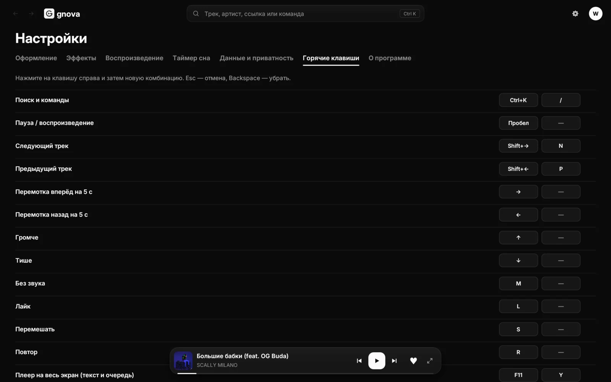
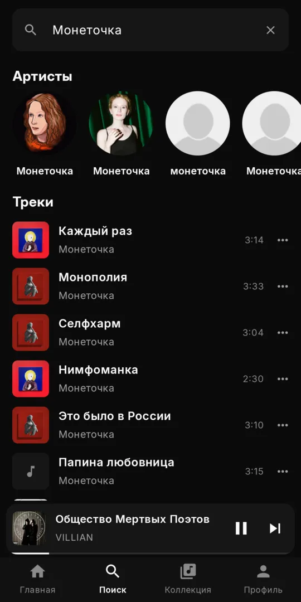
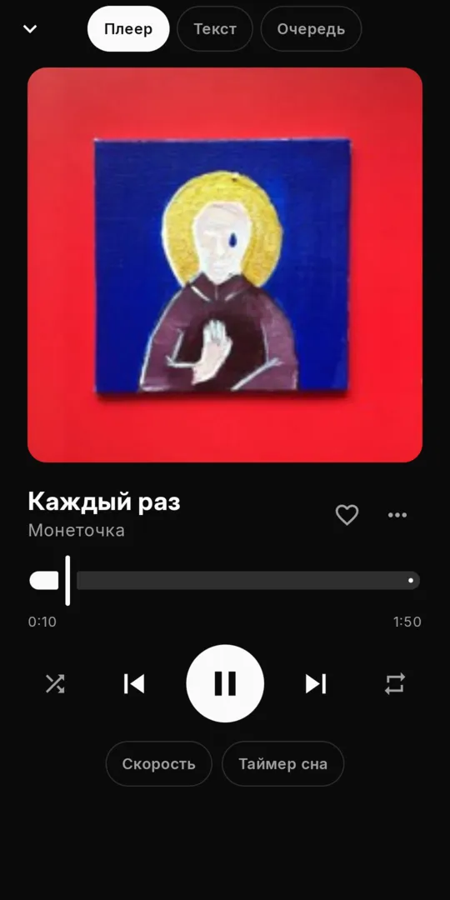
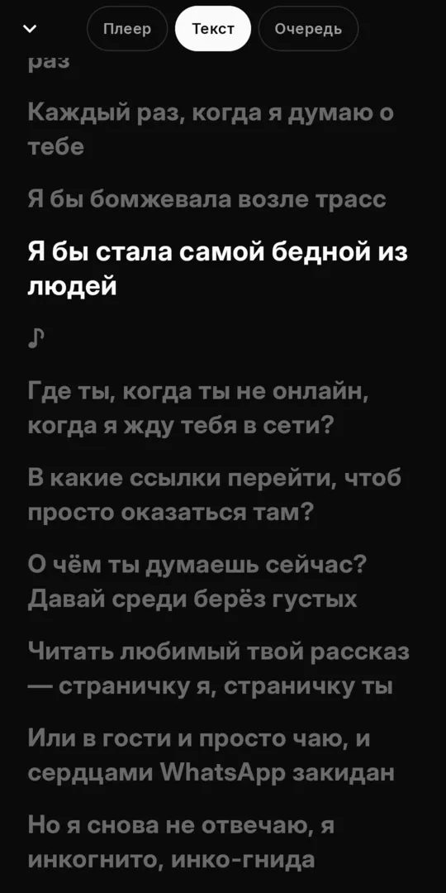

<p align="center">
  
</p>

<h1 align="center">Gnova Music</h1>

<p align="center">
  Быстрый музыкальный плеер для компьютера и Android: SoundCloud, синхронный текст песен,
  «Моя волна», без рекламы, аккаунта и сбора данных.
</p>

<p align="center">
  <a href="https://github.com/W1nq-coder/gnova-music-download/releases/latest/download/Gnova-Setup-Windows.exe"><b>⬇ Скачать для Windows</b></a>
  &nbsp;·&nbsp;
  <a href="#linux"><b>⬇ Установить на Linux</b></a>
  &nbsp;·&nbsp;
  <a href="https://github.com/W1nq-coder/gnova-music-download/releases/latest/download/Gnova-Android.apk"><b>⬇ Скачать для Android</b></a>
  &nbsp;·&nbsp;
  <a href="https://github.com/W1nq-coder/gnova-music-download/releases/latest">Все файлы</a>
</p>

<p align="center">
  
</p>

## Что умеет

- Поиск и прослушивание SoundCloud: треки, артисты, альбомы, плейлисты.
- Музыка с компьютера: перетащите файлы или папку в окно (MP3, FLAC, OGG, WAV, M4A, AAC).
- Текст песен с подсветкой текущей строки; клик по строке перематывает трек.
- «Моя волна»: бесконечная подборка по вашему вкусу.
- Любимое, плейлисты, история, таймер сна, скорость воспроизведения.
- Темы и цвета, прозрачность окна, обложки в цвет интерфейса.
- Окно подстраивается под любой экран: от узкого окна до большого монитора.
- Нет аккаунта, рекламы и аналитики: всё хранится только у вас на компьютере.

## Как это выглядит

### Главная и «Моя волна»

Вкладка «Для тебя»: большая кнопка «Моя волна» и подборка артистов по вашему вкусу. Переключатель
«Знакомое / Новое» решает, что играть: ваши треки вперемешку с похожими или только то, чего вы ещё не слышали.
Рядом «Медиатека» (любимое, плейлисты, подписки) и «История».

### Страница артиста

Популярные треки, все релизы, похожие артисты и описание. Можно слушать всё подряд, перемешать,
запустить «Волну по артисту» или подписаться.

<p align="center">
  
</p>

### Текст песни

Полноэкранный плеер (`F11` или кнопка справа от плеера): обложка слева, текст справа. Текущая строка
подсвечивается, а клик по любой строке перематывает трек на неё. Размер, выравнивание, шрифт и
эффект текста меняются в настройках.

<p align="center">
  
</p>

### Любимое и плейлисты

Все лайки собраны в один плейлист. Список можно фильтровать, сортировать и переключать между
плотным видом и таблицей. Свои плейлисты создаются кнопкой «Новый плейлист», а любой из них можно
запустить как «Волну».

<p align="center">
  
</p>

### Поиск и команды: `Ctrl + K`

Одна строка для всего: найти трек, артиста или альбом, вставить ссылку или выполнить команду.
Результаты из вашей медиатеки идут первыми, а вкладки «Треки», «Артисты», «Альбомы» и «В медиатеке»
сужают поиск.

<p align="center">
  
</p>

## Настройки

Всё меняется сразу, без кнопки «Применить». Настройки разбиты на семь вкладок.

### Оформление

<p align="center">
  
</p>

- **Тема:** тёмная, светлая или как в системе.
- **Акцент:** цвет кнопки «Играть», прогресса и текущей строки текста. По умолчанию интерфейс
  чёрно-белый, цвет появляется только там, где вы его выбрали.
- **Шрифт, обложки** (цветные, чёрно-белые или чёрно-белые с цветом при наведении), **плотность**
  списков, **скругления** углов, **язык** (русский и English) и **масштаб интерфейса**.

### Эффекты

<p align="center">
  
</p>

- **Анимации** и их скорость: плавно, обычно, быстро. Можно выключить совсем.
- **Глянец:** стеклянный блик на карточках, строке поиска и мини-плеере, со своей силой.
- **Непрозрачность окна:** при значении ниже 100 % сквозь плеер виден рабочий стол
  (нужен композитор: KDE, GNOME, Hyprland и подобные).
- **Фон по обложке:** фон плавно окрашивается в цвета играющего трека.
- Под настройками есть живой предпросмотр, видно сразу, как это выглядит.

Другие вкладки: **«Воспроизведение»** (громкость, скорость, продолжение с места остановки,
похожие треки после очереди, режим «Моей волны»), **«Таймер сна»** и **«О программе»**.

### Данные и приватность

<p align="center">
  
</p>

- **История и статистика** хранятся только на вашем компьютере. Их можно выключить или удалить
  одной кнопкой, лайки, плейлисты и подписки при этом остаются.
- **Тексты песен из интернета:** для поиска на lrclib.net отправляются только название трека и имя
  артиста. Выключатель отключает поиск совсем.
- **Медиаклавиши и виджет плеера:** связь с рабочим столом идёт локально, через D-Bus, наружу ничего
  не уходит.
- Показаны папки с медиатекой, настройками и кэшем обложек, у каждой кнопка «Открыть папку».
  Кэш обложек ограничен 400 МБ и чистится сам, его можно очистить вручную.

### Горячие клавиши

<p align="center">
  
</p>

У каждого действия две комбинации. Чтобы поменять, нажмите на клавишу справа и затем на новую
комбинацию. `Esc` отменяет, `Backspace` убирает комбинацию.

### Темы

Тёмная, светлая и любой цвет акцента: в настройках выбирается один из готовых или свой.
Включите «Фон по обложке», и интерфейс подстроится под играющий трек.

<p align="center">
  
  
</p>

## Системные требования

| Система | Что нужно |
|---|---|
| **Windows** | Windows 10 или 11, 64-бит |
| **Linux** | x86_64, glibc 2.35+ (Ubuntu 22.04+, Debian 12+, Fedora 36+, Arch/CachyOS/Manjaro и др.), Wayland или X11 |
| **Android** | Android 8.0 или новее, телефон с 64-бит (почти все с 2017 года) или 32-бит ARM |
| **macOS** | пока нет |

Нужен интернет для SoundCloud и текстов песен; музыка с диска играет и без него.

## Windows

### Способ 1: установщик (проще всего)

1. Скачайте **[Gnova-Setup-Windows.exe](https://github.com/W1nq-coder/gnova-music-download/releases/latest/download/Gnova-Setup-Windows.exe)**.
2. Запустите его. Права администратора не нужны.
3. Выберите, нужен ли ярлык на рабочем столе и запуск вместе с Windows, и нажмите «Установить».

Gnova появится в меню «Пуск». Удалить: **Параметры → Приложения → Gnova Music → Удалить**.

> **Windows показала «Windows защитила ваш компьютер»?** Это обычное предупреждение для программ
> без платной цифровой подписи. Нажмите **«Подробнее» → «Выполнить в любом случае»**.

### Способ 2: одной командой

Откройте **PowerShell** и вставьте:

```powershell
irm https://raw.githubusercontent.com/W1nq-coder/gnova-music-download/main/install.ps1 | iex
```

Скрипт скачает установщик и сам поставит Gnova с ярлыком на рабочем столе.

### Способ 3: без установки

Скачайте **[gnova-windows-x64.zip](https://github.com/W1nq-coder/gnova-music-download/releases/latest/download/gnova-windows-x64.zip)**,
распакуйте в любую папку и запустите `gnova.exe`.

## Linux

### Способ 1: одной командой

Откройте терминал и вставьте:

```bash
curl -fsSL https://raw.githubusercontent.com/W1nq-coder/gnova-music-download/main/install.sh | bash
```

Root не нужен. Gnova установится в `~/.local/bin` и появится в меню приложений.

### Способ 2: вручную

```bash
wget https://github.com/W1nq-coder/gnova-music-download/releases/latest/download/gnova-linux-x86_64.tar.gz
tar -xzf gnova-linux-x86_64.tar.gz
./gnova/gnova --install     # в меню приложений
# или просто запустить:  ./gnova/gnova
```

### Если не запускается

Gnova использует стандартные библиотеки рабочего стола. Обычно они уже стоят, если нет — поставьте:

| Дистрибутив | Команда |
|---|---|
| Arch, CachyOS, Manjaro | `sudo pacman -S --needed alsa-lib gtk3 libxkbcommon` |
| Ubuntu, Debian, Mint | `sudo apt install libasound2 libgtk-3-0 libxkbcommon0` |
| Fedora | `sudo dnf install alsa-lib gtk3 libxkbcommon` |

### Удаление

```bash
curl -fsSL https://raw.githubusercontent.com/W1nq-coder/gnova-music-download/main/uninstall.sh | bash
```

Медиатека и настройки при этом остаются. Чтобы удалить и их, скачайте `uninstall.sh` и запустите
`bash uninstall.sh --purge`.

## Android

Версия для телефона: тот же поиск по SoundCloud, «Моя волна», артисты и альбомы, плейлисты, синхронный
текст песен, таймер сна. Музыка играет в фоне, с кнопками в шторке уведомлений и на экране блокировки.

<p align="center">
  
  
  
</p>

### Установка

Приложения нет в Google Play и RuStore, оно ставится файлом `.apk` прямо с GitHub.

1. Откройте на телефоне [эту ссылку](https://github.com/W1nq-coder/gnova-music-download/releases/latest/download/Gnova-Android.apk), файл `Gnova-Android.apk` (около 12 МБ) скачается в «Загрузки».
2. Нажмите на скачанный файл. Телефон скажет, что установка из этого источника запрещена: нажмите **«Настройки»** и включите **«Разрешить установку из этого источника»** для браузера (или менеджера файлов), которым скачивали. Вернитесь назад.
3. Нажмите **«Установить»**. На телефонах Xiaomi, Redmi и POCO может появиться проверка безопасности: выберите **«Установить всё равно»**.
4. Откройте Gnova Music. На Android 13 и новее разрешите уведомления: в них живёт плеер.

Если «Установить» недоступно, зайдите в «Настройки → Приложения → Специальный доступ → Установка неизвестных приложений» и разрешите браузеру.

**Способ для тех, кто на компьютере:** включите на телефоне «Отладку по USB», подключите кабель и выполните
`adb install Gnova-Android.apk`.

### Обновление

Скачайте новый `Gnova-Android.apk` и установите поверх старого. Медиатека и настройки сохранятся: все версии
подписаны одним ключом.

### Если музыка останавливается в фоне

Многие оболочки Android сами «усыпляют» приложения, чтобы экономить батарею. Выключите это для Gnova Music:

| Телефон | Что сделать |
|---|---|
| **Xiaomi, Redmi, POCO** | «Настройки → Приложения → Все приложения → Gnova Music»: **Автозапуск** включить; **Контроль активности** (или «Экономия заряда») → **«Нет ограничений»**. В «Недавних» потяните карточку приложения вниз и нажмите на замок, чтобы закрепить его. |
| **Samsung** | «Настройки → Батарея → Ограничения в фоне»: уберите Gnova Music из «Спящих» и «Глубоко спящих» приложений. |
| **Huawei, Honor** | «Настройки → Батарея → Запуск приложений → Gnova Music»: отключите автоматическое управление и включите «Автозапуск», «Косвенный запуск», «Работа в фоновом режиме». |
| **OPPO, realme, OnePlus** | «Настройки → Приложения → Gnova Music → Использование батареи»: **«Разрешить работу в фоне»**. |
| **vivo, iQOO** | «Настройки → Батарея → Работа в фоне»: разрешите Gnova Music. |
| **Чистый Android, Pixel** | Обычно ничего менять не нужно. |

### Что есть и чего пока нет

- Есть: поиск и ссылки SoundCloud, «Моя волна» («Знакомое» и «Новое»), страницы артистов и альбомов, любимое, плейлисты,
  история, текст песен с перемоткой по строке, очередь, перемешивание и повтор, скорость, таймер сна, тёмная и светлая
  тема, акценты, русский и английский язык, статистика прослушивания.
- Пока нет: воспроизведения файлов с памяти телефона, эквалайзера и настройки шрифтов. Это есть только в версии для компьютера.
- Некоторые платные треки SoundCloud отдаёт только 30-секундным фрагментом. Это ограничение самого сервиса, так же и на компьютере.
- Если провайдер замедляет картинки SoundCloud, обложки приходят в уменьшенном размере.

### Проверка подписи

Все версии подписаны одним ключом. SHA-256 отпечаток сертификата:

```
21:86:19:06:4F:EC:DE:A4:9E:CD:72:0B:9C:A0:BD:74:44:4C:8D:71:8B:C5:33:53:B0:77:E0:E0:5B:31:B7:5F
```

Проверить скачанный файл можно командой `apksigner verify --print-certs Gnova-Android.apk`. Если отпечаток другой,
файл не от нас: не устанавливайте его.

### Удаление

Как обычное приложение: долгое нажатие на значок → «Удалить». Вместе с приложением удалятся медиатека и настройки.

## Где хранятся ваши данные

Всё хранится только на вашем устройстве и никуда не отправляется.

| | Windows | Linux | Android |
|---|---|---|---|
| Медиатека (любимое, плейлисты, история) | `%APPDATA%\gnova` | `~/.local/share/gnova` | внутренняя память приложения |
| Настройки | `%APPDATA%\gnova` | `~/.config/gnova` | внутренняя память приложения |
| Кэш обложек | `%LOCALAPPDATA%\gnova` | `~/.cache/gnova` | кэш приложения («Настройки → Приложения → Gnova Music → Очистить кэш») |

Тексты песен ищутся на [lrclib.net](https://lrclib.net) по названию и исполнителю. Это можно
выключить в «Настройки → Данные и приватность».

## Горячие клавиши

| Клавиша | Действие |
|---|---|
| `Пробел` | пауза / продолжить |
| `Ctrl + K` | поиск и команды |
| `F11` | плеер на весь экран: текст и очередь |
| `L` | в любимое |
| `S` / `R` | перемешать / повтор |
| `M` | без звука |

Полный список в «Настройки → Горячие клавиши».

---

<details>
<summary><b>English</b></summary>

**Gnova Music** is a fast music player for desktop and Android: SoundCloud, synced lyrics,
an endless "My wave" mix. No ads, no account, no tracking.

- **Windows 10/11 (64-bit):** download
  [Gnova-Setup-Windows.exe](https://github.com/W1nq-coder/gnova-music-download/releases/latest/download/Gnova-Setup-Windows.exe)
  and run it (no admin rights). If SmartScreen warns, click *More info → Run anyway*.
  Or in PowerShell: `irm https://raw.githubusercontent.com/W1nq-coder/gnova-music-download/main/install.ps1 | iex`
- **Linux (x86_64, glibc 2.35+):**
  `curl -fsSL https://raw.githubusercontent.com/W1nq-coder/gnova-music-download/main/install.sh | bash`
- **Android 8.0+:** download
  [Gnova-Android.apk](https://github.com/W1nq-coder/gnova-music-download/releases/latest/download/Gnova-Android.apk),
  tap it and allow installing from your browser when asked (on Xiaomi choose *Install anyway*).
  The app is not on Google Play. To keep music playing in the background, turn off battery
  optimisation for Gnova Music (see the Android section above). Local files on the phone are not supported yet.
- **macOS:** not yet.

All your data stays on your device.
</details>
